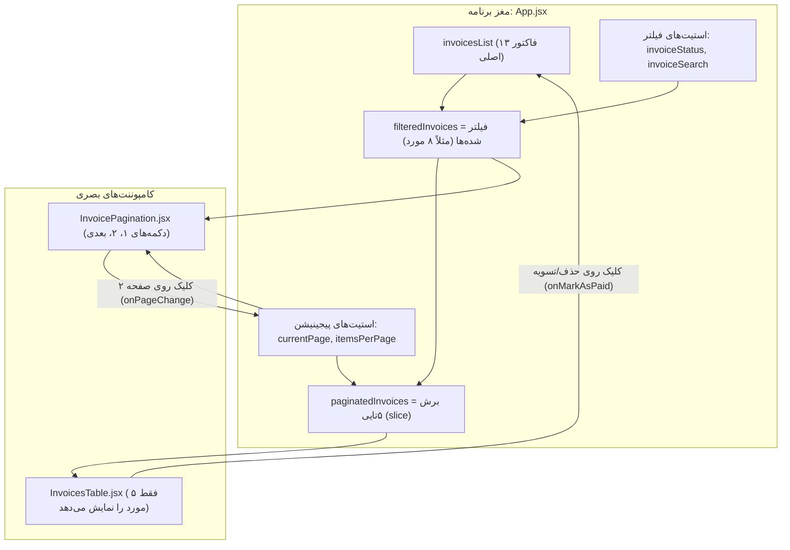

# 🎓 راهنمای گام‌به‌گام: جریان استیت‌ها (State Flow)، فیلتر و صفحه‌بندی چطور کار می‌کنند؟

> این راهنما دقیقاً توضیح می‌دهد که پشت صحنه کدها چه اتفاقی می‌افتد، استیت‌ها چطور بین کامپوننت‌ها می‌چرخند و چطور دکمه‌های صفحه‌بندی محتوای جدول را عوض می‌کنند.

---

## ۱. نقشه کلی جریان داده‌ها (Data Flow Architecture)

در ری‌اکت، اصل طلایی **«جریان یک‌طرفه داده‌ها» (One-Way Data Flow)** است:
اطلاعات همیشه از بالا (کامپوننت والد یعنی `App.jsx`) به سمت پایین (فرزندان یعنی `InvoicesTable` و `InvoicePagination`) حرکت می‌کند.



---

## ۲. زنجیره تبدیل داده‌ها در ۵ مرحله ساده

بیایید فرض کنیم **۱۳ فاکتور** در سیستم داریم و کاربر می‌خواهد آن‌ها را صفحه به صفحه ببیند.

### مرحله ۱: دیتای خام در استیت اصلی
```javascript
const [invoicesList, setInvoicesList] = useState(INITIAL_INVOICES_DATA); // ۱۳ فاکتور
```

### مرحله ۲: فیلتر کردن هوشمند
قبل از این‌که چیزی به جدول برود، بر اساس جستجوی کاربر و تب‌های وضعیت، دیتای اولیه فیلتر می‌شود:
```javascript
const filteredInvoices = invoicesList.filter(inv => {
  // اگر فیلتر وضعیت ست شده باشد و با فاکتور نخواند، حذف شود
  if (invoiceStatus !== 'all' && inv.status !== invoiceStatus) return false;
  // اگر متن جستجو در نام مشتری یا پروژه نباشد، حذف شود
  if (invoiceSearch && !inv.client.includes(invoiceSearch)) return false;
  return true;
});
```
*نتیجه:* فرض کنیم هنوز همه ۱۳ فاکتور معتبرند.

---

### مرحله ۳: ریاضی ساده صفحه‌بندی (جادوی اصلی!)

ما ۲ متغیر در استیت داریم:
- `currentPage`: در حال حاضر صفحه چندم هستیم؟ (پیش‌فرض: `1`)
- `itemsPerPage`: در هر صفحه چند ردیف نشان دهیم؟ (پیش‌فرض: `5`)

حالا با ۳ فرمول ساده ریاضی، صفحات را قطعه‌بندی می‌کنیم:

```javascript
// ۱. تعداد کل صفحات (۱۳ تقسیم بر ۵ رُند به بالا = ۳ صفحه)
const totalPages = Math.ceil(filteredInvoices.length / itemsPerPage); // 3

// ۲. ایندکس شروع برش برای صفحه جاری:
// صفحه ۱: (1 - 1) * 5 = 0  --> از ایندکس ۰ تا ۵
// صفحه ۲: (2 - 1) * 5 = 5  --> از ایندکس ۵ تا ۱۰
// صفحه ۳: (3 - 1) * 5 = 10 --> از ایندکس ۱۰ تا ۱۳
const startIndex = (currentPage - 1) * itemsPerPage;

// ۳. بریدن دقیق ۵ آیتم برای صفحه جاری با متد جاوااسکریپت .slice()
const paginatedInvoices = filteredInvoices.slice(startIndex, startIndex + itemsPerPage);
```

---

### مرحله ۴: تحویل بسته‌ی ۵تایی به جدول
به جای اینکه تمام ۱۳ فاکتور را به جدول بدهیم، فقط همان تکه بریده‌شده (`paginatedInvoices`) را تحویل می‌دهیم:

```jsx
<InvoicesTable 
  invoices={paginatedInvoices}  // فقط ۵ آیتم دارد!
  ...
/>
```

کامپوننت `InvoicesTable.jsx` هیچ کار پیچیده‌ای نمی‌کند! فقط روی این ۵ تا حلقه `map` می‌زند و ۵ ردیف جدول را رسم می‌کند.

---

### مرحله ۵: کاربر روی دکمه «صفحه ۲» کلیک می‌کند (رویداد بازگشتی / Callback)

1. در نوار پایین (`InvoicePagination.jsx`):
   ```jsx
   <button onClick={() => onPageChange(2)}> ۲ </button>
   ```
2. با کلیک کاربر، تابع ارسالی از بالا اجرا می‌شود:
   ```javascript
   onPageChange(2) ---> setCurrentPage(2)
   ```
3. ری‌اکت متوجه می‌شود استیت `currentPage` از `1` به `2` تغییر کرده است.
4. کل کامپوننت `App` مجدداً اجرا می‌شود (**Re-render**).
5. فرمول مرحله ۳ دوباره محاسبه می‌شود:
   `startIndex` حالا می‌شود `5` و `paginatedInvoices` می‌شود فاکتورهای شماره **۶ تا ۱۰**.
6. جدول بلافاصله ردیف‌های صفحه ۲ را نشان می‌دهد! بدون هیچ لودینگی و کاملاً در حافظه مرورگر.

---

## ۳. چرا وقتی فیلتر عوض می‌شود، صفحه باید ۱ شود؟

فرض کنید کاربر در **صفحه ۳** جدول است (فاکتورهای ۱۱ تا ۱۳).  
حالا کاربر فیلتر را روی «فاکتورهای معوقه» می‌گذارد که کلاً **۲ فاکتور** دارد!  
اگر صفحه هنوز روی ۳ بماند، چون فاکتورهای ۱۱ تا ۱۳ وجود ندارند، کاربر با یک صفحه خالی مواجه می‌شود!

به همین دلیل، هر وقت فیلتری عوض می‌شود، ما صفحه را به ۱ برمی‌گردانیم:
```javascript
onStatusChange={(status) => {
  setInvoiceStatus(status);
  setCurrentPage(1); // بازگشت به اول
}}
```

---

## ۴. ارتباط این بخش‌ها با React Router v6

در فایل `src/main.jsx`:
- کل اپ داخل `<BrowserRouter>` قرار گرفته تا آدرس بار مرورگر را زیر نظر داشته باشد.

در فایل `src/components/layout/Navbar.jsx`:
- دکمه‌ها تبدیل به `<NavLink to="/invoices">` شدند. وقتی روی تب فاکتورها کلیک می‌کنید، آدرس مرورگر به `/invoices` تغییر می‌کند.

در فایل `src/App.jsx`:
- با دستور `<Route path="/invoices" element={<InvoicesPage>...}/>`، ری‌اکت می‌فهمد که هر وقت کاربر در آدرس `/invoices` بود، جدول و فیلترها را نشان دهد و اگر در `/` بود، داشبورد را نمایش دهد.

---

## ۵. خلاصه کلام برای مصاحبه یا پرزنت

> «در FreelanceOS، معماری داده‌ها به‌صورت **Client-Side Slicing** پیاده‌سازی شده است: دیتای فاکتورها از استیت مرکزی فیلتر شده و بر اساس `currentPage` و `itemsPerPage` با متد استاندارد `Array.prototype.slice` به بخش‌های بهینه بریده می‌شود. کامپوننت‌های جدول و صفحه‌بندی کاملاً **Controlled Components** و ناب هستند و به هیچ دیتای سراسری وابسته نیستند، بلکه فقط از طریق Props و Callbacks با والد در ارتباطند.»
